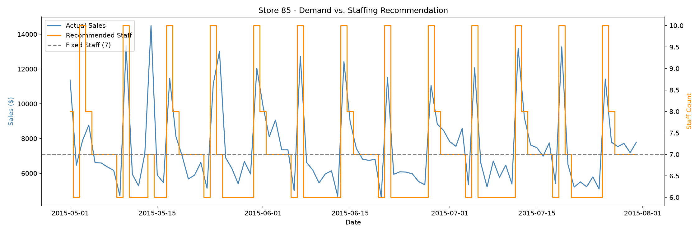

# Demand-Driven Staffing Optimization

**Can we cut labor costs without hurting service by staffing to predicted demand instead of a fixed schedule?**

This project rebuilds, on public data, the same type of analysis I used at Tokyo Restaurant Group to reduce operating expenses by 8% - forecasting demand and aligning staffing to it rather than staffing on a flat, intuition-based schedule.

## Buisness Problem

Most retail/restaurant operations staff on a fixed weekly schedule that doesn't flex with actual demand. That creates two costly failure modes: overstaffing during predictably slow periods, and understaffing during demand spikes. 

**Goal:** Build a demand forecast, translate it into a staffing recommendation, and quantify the real trade-off vs. a naive fixed-staffing baseline.

## Data

[Rossmann Store Sales](https://www.kaggle.com/competitions/rossmann-store-sales) (Kaggle) - daily sales for 1.115 stores, including promotions, holidays, and store metadata.

Rossmann doesn't include actual staffing data, so I built a transparent, documented staffing rule from sales volume (2 minimum staff + 1 per $1,500 in daily sales) - a normal step in operational analytics when real staffing data isn't public.

## Method

1. Explored demand patterns for a sample store (Store #85)
2. Built a baseline forecast using day-of-week averages
3. Built an improved forecast using gradient boosting, adding promotions and holiday features
4. Converted the forecast into a staffing recommendation using a documented rule
5. Compared total labor cost: demand-driven staffing vs. a flat fixed schedule

## Results

- **Forecast accuracy:** improved from a 13.0% MAPE baseline (day-of-week average) to **9.8% MAPE** using gradient boosting with promo/holiday features - a ~25% relative improvement.
- **Feature importance:** day-of-week drove ~79% of the model's predictions, promotions ~18%, holidays had minimal impact for this store.
- **Demand pattern:** Sunday sales averaged **$11,336** - 73% higher than the weekday average.
- **Staffing trade-off:** demand-driven staffing cost **$840 more** (1.1%) over a 92-day test period than a flat 7-person/day schedule - but the fixed schedule would have **understaffed the store on 21 of 92 days (22.8%)**, every one of them a high-demand day. For roughly $9/day extra, demand-driven staffing avoids understaffing on nearly a quarter of operating days.

## Tools

Python (pandas, scikit-learn), matplotlib

## Author

Joanna Ni - [Linkedin](https://linkedin.com/in/joannani)